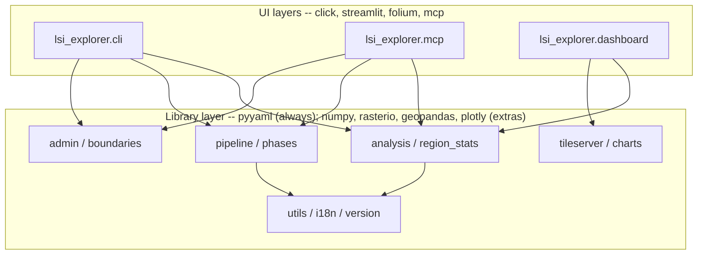

# Architecture

## Requirements

- Process the GeoLaSS land suitability rasters (present and future climate scenarios) into change
  rasters, class transitions and dominant climate drivers.
- Compute statistics for the whole study area, a county (judet) or a UAT, at full resolution.
- Offer every capability from Python, from the command line and as MCP tools.
- Provide an interactive dashboard deployable on EOCube.Ro (JupyterHub + jupyter-server-proxy).
- Minimal footprint when used as a library: optional dependencies grouped in extras.

## Package structure

The code lives in `src/lsi_explorer` and is split into layers. Library modules never import
from the CLI layer, the MCP layer or the dashboard.

### Library layer

| Module | Purpose |
|---|---|
| `utils` | paths (env-overridable), constants, crop names, scenario discovery, `catalog_info` |
| `preprocessing` | cleaning, alignment and masking of the input rasters |
| `raster_ops` | raster I/O, grids, windows, cross-tabulation |
| `region_stats` | full-resolution statistics for a window + polygon mask |
| `analysis` | `area_window`, `area_statistics` (whole area / county / UAT) |
| `admin` | loading and filtering county / UAT boundaries, area selection |
| `boundaries` | download of the boundaries from the geo-spatial.org WFS |
| `phase1_deltas`, `phase2_transitions`, `phase3_attribution` | Phases 1-3 |
| `pipeline` | `run()`: batch processing of Phases 1-3 |
| `charts` | Plotly figures (transition matrices, class dynamics, drivers, change classes) |
| `tileserver` | local XYZ tile server rendering rasters at native resolution |
| `i18n` | `t("dot.key")` translations from `locales/{lang}.yml` |
| `version`, `_build_info` | version string and build provenance |

### CLI layer (`lsi_explorer.cli`, Click)

`lsi` commands are thin wrappers over library functions. `lsi app` and `lsi mcp serve` start
servers and therefore have no MCP counterpart. `cli/mcp.py` is the MCP transport entry point.

### MCP layer (`lsi_explorer.mcp`)

Transport-pure (no click / rich). `tools.py` holds plain functions decorated with
`@guarded(...)` (never raise, return `-> dict`); `server.build_server()` registers them on
FastMCP with `ToolAnnotations` (read-only / write; destructive tools only with
`allow_destructive`). Large results are written by `_artifacts.save_json` and read back with
`load_json`.

### Dashboard (`lsi_explorer.dashboard`, Streamlit)

UI layer: may use streamlit / folium; all computations come from the library.

## Localization

`EOCUBE_LANG` -> `LC_ALL` / `LC_MESSAGES` / `LANG` -> `locale.getlocale()` -> `en`; the CLI
accepts `--lang`, the dashboard `?lang=`. Shipping `en` and `ro`.

## Testing

| File | Scope |
|---|---|
| `tests/conftest.py` | synthetic LSI dataset fixture, English default |
| `tests/test_architecture.py` | layer boundaries, MCP purity, lightweight package import |
| `tests/test_cli.py` | command tree and commands (external calls mocked) |
| `tests/test_mcp.py` | tools never raise, file hand-off, CLI <-> MCP parity, destructive gating |
| `tests/test_end_to_end.py` | statistics, Phase 1 and tile rendering on synthetic rasters |
| `tests/test_classification.py`, `tests/test_charts.py`, `tests/test_admin.py` | rules, charts, boundaries |
| `tests/test_i18n_version.py` | language detection, locale parity, version string |
| `tests/test_charset_policy.py` | ASCII-only sources |
